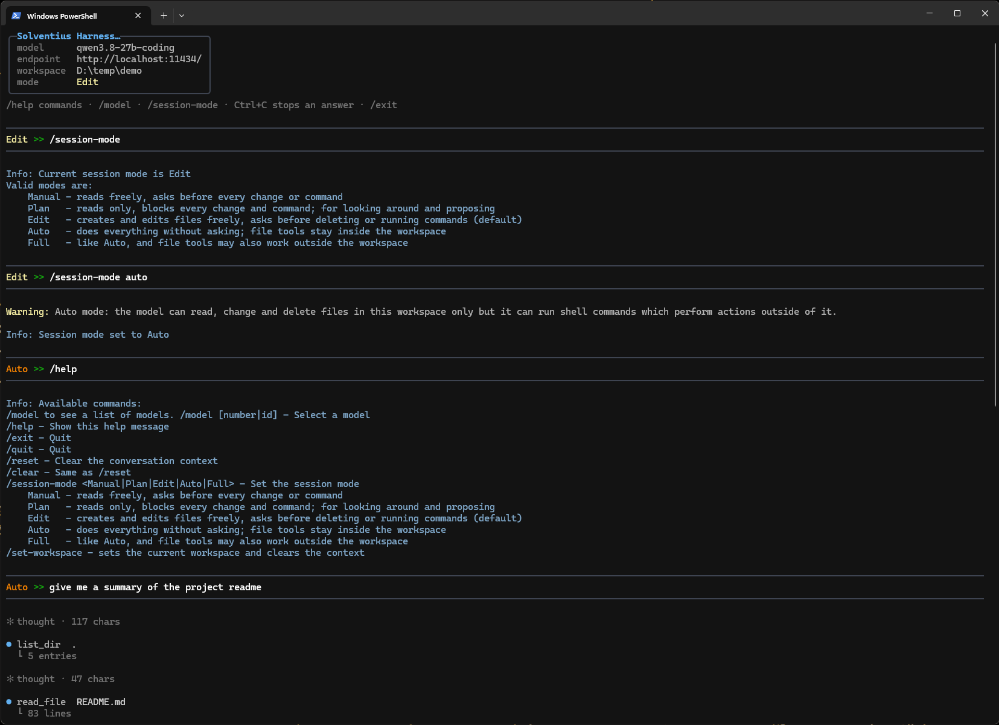
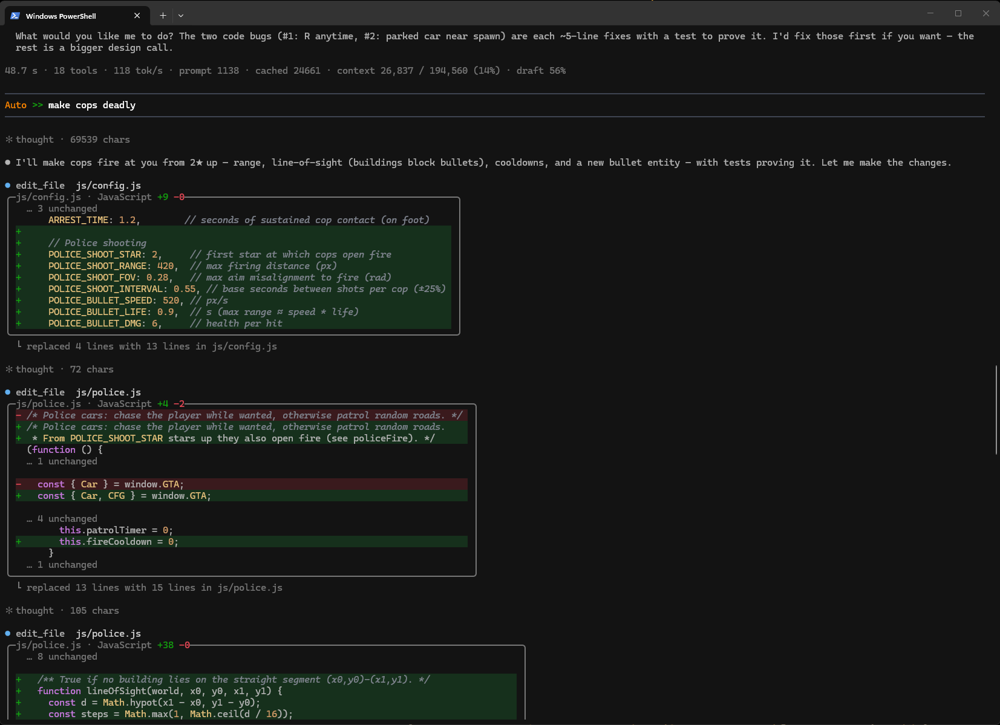

# Solventius Harness

> **Demo.** Free for personal, non-commercial evaluation only. No copying, no redistribution. See [LICENSE](LICENSE).

Personal terminal agentic assistant for **local language models**. You chat with a model; it reads, searches, creates and edits
files in one folder you choose, and runs commands after you allow them. Good for many things, but built with coding in mind.

What I started initially as a learning project for understanding agentic coding, ended up as a tool that I am using all the time. Inspiration came from 
pi.dev, with the difference that I wanted more specialized tools for game developemnt (might get there eventually).

It does not include a model. It connects to any **OpenAI-compatible server** you run: llama.cpp `llama-server`,
llama-swap, Ollama, LM Studio.

**[Download the latest release](https://github.com/sbularca/solventius-harness/releases/latest)** · [Changelog](CHANGELOG.md)

## Requirements

- Windows x64, Linux x64, or macOS (arm64 / x64, untested). No .NET install needed.
- A model server with an OpenAI-compatible API. The model should support **tool calling**; others can only chat.

| Server | Endpoint |
|---|---|
| llama.cpp `llama-server` | `http://localhost:8080/` |
| Ollama | `http://localhost:11434/` |
| LM Studio | `http://localhost:1234/` |

## Install

1. Download the zip for your system from the [releases page](https://github.com/sbularca/solventius-harness/releases/latest) and unzip it.
2. Linux / macOS: `chmod +x slvh`. macOS, if blocked: `xattr -d com.apple.quarantine slvh`.
3. Check it works: `slvh --selftest`. Every line must say `PASS` or `SKIP`.

## Configure

Start `slvh` once. It creates `settings.json` next to the program. Close it with `/exit`, then edit it:

```json
{
  "default_model": "my-model",
  "models": [
    {
      "id": "my-model",
      "endpoint": "http://localhost:8080/",
      "context_size": 32768,
      "max_tokens": 8192
    }
  ]
}
```

- `id`: the model name your server expects.
- `endpoint`: must start with `http://` and end with `/`.

### Web search (optional)

The `web_search` tool lets the model search the web. It needs a search server you can reach. **Recommended: 4get**, a lightweight
open-source meta search engine (repository: https://git.lolcat.ca/lolcat/4get); [SearXNG](https://docs.searxng.org) also works. Add it to `settings.json`:

```json
{
  "search_providers": [
    { "id": "4get", "endpoint": "http://localhost:8081" }
  ],
  "active_search_provider": "4get"
}
```

- `id`: `4get` or `searXNG` (not case-sensitive). You can list both; `active_search_provider` picks one.
- `endpoint`: the server address, **without** a trailing `/`.
- If `active_search_provider` is missing or unknown, the first entry is used.
- Without `search_providers`, `web_search` returns an error.

**Quick 4get with Docker** (from the [4get Docker guide](https://git.lolcat.ca/lolcat/4get/src/branch/master/docs/docker.md)):

1. `docker run -d --name 4get -p 8081:80 -e FOURGET_SERVER_NAME="localhost" -e FOURGET_PROTO="http" luuul/4get:latest`
2. Check: `http://localhost:8081/api/v1/web?s=test` in a browser returns JSON.

**SearXNG instead:** use `"id": "searXNG"` and enable JSON output in its `settings.yml` (`search:` → `formats:` → add `- json`),
otherwise every search fails.

## Run

Open a terminal **in the folder you want it to work in** and start `slvh`. Use a folder you can afford to lose, or one under git.

| Command | Effect |
|---|---|
| `/help` | List all commands |
| `/model` | List models; `/model <n>` switches |
| `/session-mode <mode>` | Change when it asks (see below) |
| `/set-workspace <folder>` | Work in another folder |
| `/reset` | Start a fresh conversation |
| `/exit` | Quit |

**Ctrl+C** stops the current answer. **Ctrl+D** quits (asks first).

### Session modes

| Mode | Reads | Writes | Deletes, commands |
|---|---|---|---|
| `Manual` | run | ask | ask |
| `Plan` | run | blocked | blocked |
| `Edit` (default) | run | run | ask |
| `Auto` | run | run | run |
| `Full` | run | run | run, and outside the workspace |

### herdr support

Supports [herdr](https://herdr.dev), a terminal multiplexer for coding agents. In a herdr pane the harness reports its
state: **idle** while waiting for you, **working** while the model answers, **blocked** while it waits for you to allow
a tool. Nothing to set up; outside herdr nothing changes.

## Tools

| Tool | Does |
|---|---|
| `read_file`, `list_dir`, `grep` | Read and search files in the workspace |
| `create_file`, `edit_file` | Create a new file, replace text in a file |
| `delete_file_or_folder` | Delete (never the workspace itself) |
| `run_shell` | PowerShell on Windows, `/bin/sh` elsewhere, 120 s timeout |
| `web_search` | Search the web; optional, needs a search server ([setup](#web-search-optional)) |

Put an `AGENTS.md` in the workspace to give the model project rules (build commands, what not to touch).

## Troubleshooting

| Symptom | Fix |
|---|---|
| `Connection refused` | Server not running, or wrong `endpoint` |
| `HTTP 404` | Wrong model `id` |
| Only chats, never uses files | The model doesn't support tool calling |
| Error after a long conversation | Context full: `/reset` |
| `Permission denied` (Linux / macOS) | `chmod +x slvh` |
| `error: no search provider available` | Add `search_providers` to `settings.json`, see [Web search](#web-search-optional) |
| Web search returns an HTTP error | Server down or wrong `endpoint`; for SearXNG, `json` missing in `formats` |

## Roadmap

Planned, roughly in this order. No dates; plans change.

**Next**

- **Cloud models:** Gemini (free tier) and other OpenAI-compatible APIs with an API key, so you can start without a local model server.
- **Long sessions:** automatic context management, so a long conversation keeps working instead of hitting the limit.
- **Images:** `/image <file>` to show the model a picture (for models with vision).
- **Smoother confirmations:** answer "always" for a tool once per session; safe read-only commands run without asking in `Auto`.
- **Bigger files:** `read_file` reads large files in parts instead of all at once.
- **Debuggable reports:** a session log file and `--version`.

**Later**

- **Extensions:** skills (`SKILL.md` instructions loaded on demand) and MCP servers as extra tools.
- **Web:** `web_fetch` to read a page, web search without hosting your own search server.
- **Setup:** detect model settings from the server; guided first-run setup with a bundled local model.
- **Sessions:** save and resume a conversation; remember facts across sessions.
- **Sub-agents:** hand a self-contained task to a fresh agent with its own context.
- **Native builds:** compiled to native code for faster start-up and a smaller footprint.

## Built with

Small and self-contained: one file of about 16–18 MB, no installer, no .NET install needed. It aims for a very low
performance footprint, so CPU, memory and GPU stay free for the model.

- **C# / .NET 10**, published as a trimmed single file with the runtime included.
- **[Spectre.Console](https://spectreconsole.net)** for the terminal UI (MIT), the only dependency beyond .NET itself.
  Thanks to its authors.

**How it's made:** the core (agent loop, tools, model communication, session modes, settings) is written by hand.
AI is used as a helper, not a replacement: mainly Claude, and to a lesser extent Qwen 3.8, for planning and
project management, code review, all unit tests and part of the manual testing, parts of the terminal UI code, the build
and release scripts, and most of the documentation.

Third-party licences: [THIRD-PARTY-NOTICES.md](THIRD-PARTY-NOTICES.md).

## Licence

Copyright (c) 2026 Jovian Industries. All rights reserved. Demo licence: personal, non-commercial evaluation only.
No copying, redistribution, modification or reverse engineering. Full terms in [LICENSE](LICENSE).

## Screenshots




