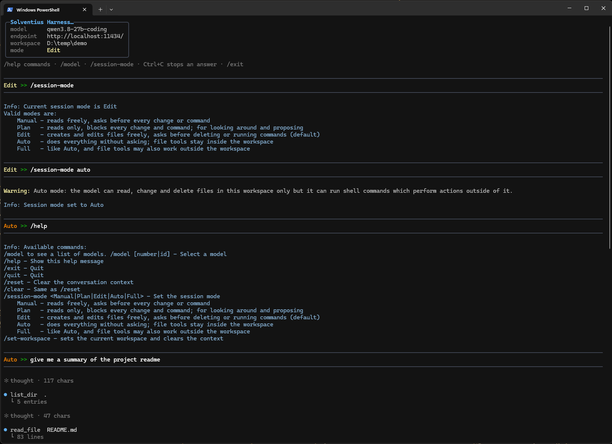
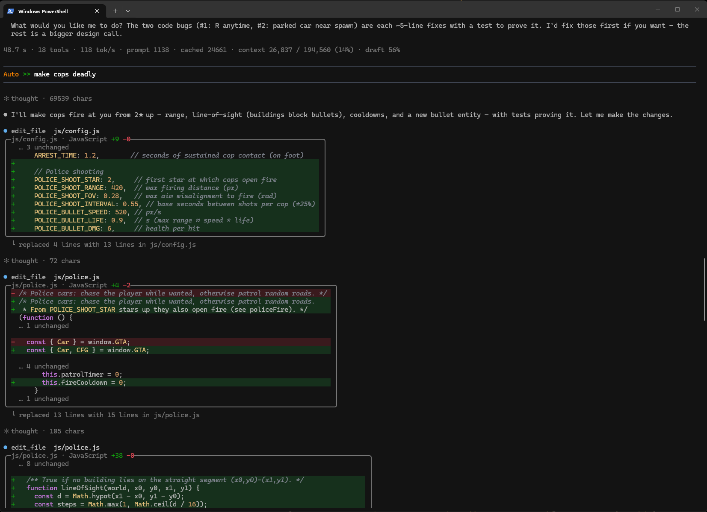

# Solventius Harness

> **Freeware.** Free to use, at home or at work. No selling, no modifying. See [LICENSE](LICENSE).

A terminal coding assistant for **local language models** and the **Claude**, **Gemini** and **OpenAI** APIs.

- You chat with a model. It reads, searches, creates and edits files in one folder you choose.
- It runs commands after you allow them.
- The same session can also run in a browser.

## Quick install

**Windows** (PowerShell):

```powershell
irm https://raw.githubusercontent.com/sbularca/solventius-harness/main/install.ps1 | iex
```

**Linux / macOS:**

```sh
curl -fsSL https://raw.githubusercontent.com/sbularca/solventius-harness/main/install.sh | sh
```

Then open a new terminal and follow [Configure](#configure). Update later with `solv --update`. Choose the folder or install by hand: [Install](#install).

You can also **[download the latest release](https://github.com/sbularca/solventius-harness/releases/latest)** as a zip.
See what changed in the [changelog](CHANGELOG.md).

**Why this one**

- **Built for local models:** shorter tool results on small contexts (32k or less), file reads sized to the context, automatic compaction.
- **Light:** one file, a low CPU and memory footprint. The machine stays free for the model.
- **Little setup:** the first start finds your local server or takes an API key. It detects the server type, lists the models and reads their context size.
- **No cloud account needed.**

It does not include a model. It started as a learning project and became a tool I use every day. Inspired by pi.dev, with
game development tools in mind for later. The source code may follow; for now this repository holds the releases.

**Features**

- **File tools:** read, list, search, find by pattern, create, edit and delete files in the workspace.
- **Shell commands:** PowerShell on Windows, `/bin/sh` elsewhere, after you allow them.
- **Session modes:** from asking before every change to running everything.
- **Many servers:** llama.cpp, llama-swap, Ollama, LM Studio, vLLM, any OpenAI-compatible server, plus Claude, Gemini and OpenAI.
- **Images:** drag and drop an image on the terminal or the web UI, or paste it or name its path, for vision models.
- **Documents:** reads the text of PDF, Word (`.docx`), Excel (`.xlsx`) and OpenDocument (`.odt`, `.ods`) files, by `read_file` or drag and drop.
- **Skills:** instructions in `SKILL.md` files that the model loads when it needs them.
- **Web:** search with your own search server, and read web pages.
- **Web UI:** the same session in a browser, also from your phone.
- **Project rules:** an `AGENTS.md` in the project, plus one for all projects.
- **[herdr](https://herdr.dev) support:** in a herdr pane it reports idle, working or blocked. Nothing to set up.

## Contents

- [Requirements](#requirements)
- [Install](#install)
- [Configure](#configure)
- [Run](#run)
- [Skills](#skills)
- [Web UI](#web-ui)
- [Tools](#tools)
- [Troubleshooting](#troubleshooting)
- [Roadmap](#roadmap)

## Requirements

- Windows x64, Linux x64, or macOS (arm64 / x64, untested). No .NET install needed.
- A model server whose model supports **tool calling** (others can only chat), or an API key for
  [Claude](https://platform.claude.com), [Gemini](https://aistudio.google.com/apikey) or [OpenAI](https://platform.openai.com).

| Server | Address (`endpoint`) |
|---|---|
| llama.cpp `llama-server`, llama-swap | `http://localhost:8080/` |
| Ollama | `http://localhost:11434/` |
| LM Studio | `http://localhost:1234/` |
| vLLM, any OpenAI-compatible server | its address |
| Gemini | `https://generativelanguage.googleapis.com/v1beta/openai/` |
| Claude | `https://api.anthropic.com/` |
| OpenAI | `https://api.openai.com/v1/` |

[↑ Back to contents](#contents)

## Install

**One command** (installs the latest release, checks its SHA-256, adds it to `PATH`; run it again to update):

- **Windows** (PowerShell): `irm https://raw.githubusercontent.com/sbularca/solventius-harness/main/install.ps1 | iex`
  → `%LOCALAPPDATA%\solv`
- **Linux / macOS**: `curl -fsSL https://raw.githubusercontent.com/sbularca/solventius-harness/main/install.sh | sh`
  → `~/solv`

Open a new terminal afterwards. Updates keep your `.solv` folder.

**Update:** `solv --update` (or `/update` in a session) downloads the latest release, checks its SHA-256 and replaces the program; start solv again afterwards. It also adds the folder to `PATH` if it is not there yet. At start, solv tells you when a new version is out (turn this off with `check_for_updates`). Running the install command again also updates.

**Choose the install folder:** set `SOLV_INSTALL_DIR`. Use the same folder for every update; it must be a folder of its own
that your user can write to (not `Program Files`, `/usr/local/bin` or `~/.local/bin`).

```powershell
$env:SOLV_INSTALL_DIR = "D:\tools\solv"; irm https://raw.githubusercontent.com/sbularca/solventius-harness/main/install.ps1 | iex
```

```sh
curl -fsSL https://raw.githubusercontent.com/sbularca/solventius-harness/main/install.sh | SOLV_INSTALL_DIR="$HOME/tools/solv" sh
```

**By hand:**

1. Download the zip for your system from the [releases page](https://github.com/sbularca/solventius-harness/releases/latest).
2. Unzip it, for example into `C:\solv` or `~/solv`.
3. Linux / macOS: run `chmod +x solv`. macOS, if blocked: `xattr -d com.apple.quarantine solv`.
4. Check it: `solv --selftest`. Every line must say `PASS` or `SKIP`.
5. Add the **folder** to `PATH`. Don't copy or link the program: its settings live in the `.solv` folder next to it.
   - **Windows:** Start menu → *Edit environment variables for your account* → **Path** → **Edit…** → **New** → `C:\solv`.
   - **Linux:** `echo 'export PATH="$HOME/solv:$PATH"' >> ~/.bashrc`
   - **macOS:** the same, into `~/.zshrc`.
6. Open a **new** terminal and run `solv --help`.

[↑ Back to contents](#contents)

## Configure

**First start:** start `solv`. A short setup runs when there is no `settings.json`:

1. Pick a model server. It looks for a local one (Ollama, llama.cpp, LM Studio) or tests the address you type.
   For Gemini, Claude or OpenAI it asks for the API key (hidden while you type), tests it and saves it.
2. Pick a model.
3. Answer a few yes/no questions: session logs, full tool results, the model's reasoning. Enter keeps "no".
4. Optional: give a 4get or SearXNG search server. It tests one search.

- **Run it again** any time with `/setup` or `solv --setup`. `/setup local|gemini|claude|openai` goes straight to one;
  `/setup preferences` and `/setup search` ask only those questions.
- **Skip it:** press Enter on an empty answer. You get a default `settings.json` to fill in by hand.

**By hand:** edit `.solv/settings.json` next to the program. Your settings go under `user_settings`. Leave `app_state`
alone; the app writes it.

> **Read-only program folder?** If `solv` cannot write next to itself (for example under `C:\Program Files`), it keeps its
> settings, keys, logs and history in `.solv` in your home folder instead.

> **Every setting, explained:** the zip includes `settings.example.jsonc`, with a comment for each setting. The harness
> does not read it. Copy the parts you need into `settings.json` **without the comments**: a comment stops the file from loading.

> **Upgrading?** A `settings.json` directly next to the program is no longer read. Move it into `.solv`. A file in the old
> layout is renamed to `settings.json.old`.

### Model servers

The setup writes this part for you. A default `settings.json` (setup skipped) already lists Gemini, Claude and OpenAI.
Delete the ones you don't use and add your local servers.

```json
{
  "user_settings": {
    "backends": [
      { "id": "home", "endpoint": "http://localhost:8080/" },
      { "id": "claude", "endpoint": "https://api.anthropic.com/", "api_key_env": "ANTHROPIC_API_KEY", "compact_at": 150000 }
    ]
  }
}
```

| Key | Meaning |
|---|---|
| `endpoint` | The server's root address, ending with `/`. |
| `id` | Optional name, shown in `/model` and in the prompt. |
| `type` | Optional, skips detection: `llama-swap`, `llama.cpp`, `ollama`, `lmstudio`, `vllm`, `ninfer`, `gemini`, `anthropic`, `openai`, `generic`. |
| `api_key_env` | The **name** of the environment variable that holds the key. Never the key itself. |
| `key_command` | A command that prints the key, for a password manager (e.g. `op read op://Private/gemini/credential`). Runs once per session, within 15 s. |
| `compact_at` | Compact the conversation at this prompt size (tokens). Default: 95 % of the usable context. On cloud models it caps the cost per request. A value above the usable context still applies, as long as about 1/16 of the context stays free for the answer. |

- **Start-up:** each server gets 5 seconds to answer. All their models show up in `/model`.
- **Per model** (optional): `user_models` overrides `context_size`, `max_tokens`, `compact_at` or `vision` for one model,
  or adds a model no server lists: `"user_models": [{ "id": "qwen3:8b", "context_size": 32768 }]`.
- **Large `max_tokens`** (some models recommend 32k for thinking) is fine. solv keeps at most 1/8 of the context free for
  the answer, and lowers `max_tokens` on a request when the conversation leaves less room.
- **Busy servers:** on HTTP 429 or 503 it waits and tries again, up to 3 times. **Esc** stops the wait. A daily quota or a
  wait over 60 seconds gives a plain message at once.

> **Privacy and cost:** with a cloud provider, your prompts and the files the assistant reads go to that provider.
> Gemini's free tier may use them to improve Google's products, so don't use it on private code. `/cost` shows your tokens.

### API keys

**Easiest:** `/setup gemini` (or `claude`, `openai`). It tests the key and saves it in `.solv/.credentials`.

- That file is readable only by you. It is **not encrypted**. Never commit or share it.
- **Order:** the `api_key_env` variable wins, then `key_command`, then the saved key.

**Hidden from the model:** shell commands get no key variables. A loaded key that shows up in a tool result or the log
becomes `[hidden]`. This stops accidental leaks only: a command can still read a key from the file where you stored it.
Read what a command does before you allow it.

**Environment variable instead:** set it, then **open a new terminal**. These commands ask for the key at a hidden prompt,
so it stays out of your shell history:

- **Windows** (PowerShell 7): `[Environment]::SetEnvironmentVariable("GEMINI_API_KEY", (Read-Host "Key" -MaskInput), "User")`
- **Linux:** `read -rsp "Key: " k && echo "export GEMINI_API_KEY='$k'" >> ~/.bashrc && unset k && chmod 600 ~/.bashrc`
- **macOS:** `read -rs "k?Key: " && echo "export GEMINI_API_KEY='$k'" >> ~/.zshrc && unset k && chmod 600 ~/.zshrc`

**Claude:** create the key **inside a workspace** in the Claude Console. Other keys are refused.

### Web search (optional)

The `web_search` tool needs a search server: [4get](https://git.lolcat.ca/lolcat/4get) (recommended) or
[SearXNG](https://docs.searxng.org) (add `json` under `search:` → `formats:` in its `settings.yml`).

```json
"search_providers": [{ "id": "4get", "endpoint": "http://localhost:8081" }],
"active_search_provider": "4get"
```

- `/setup search` adds one and tests it. Without a search server, the model does not get `web_search`.
- The `endpoint` has **no** trailing `/`.
- Quick 4get: `docker run -d --name 4get -p 8081:80 -e FOURGET_SERVER_NAME="localhost" -e FOURGET_PROTO="http" luuul/4get:latest`

### Other settings (optional)

All go inside `user_settings`.

| Key | Meaning | Default |
|---|---|---|
| `auto_compact` | Compact by itself near the limit. `false`: only `/compact`, and once after a "context too long" error. | `true` |
| `compact_at` | Compact at this prompt size (tokens), for every model without its own value. | 95 % of the usable context |
| `request_timeout` | Seconds to wait for one answer. | `600` |
| `shell_judge_model` | Auto mode: the model that checks shell commands. Empty = the model you chat with. A model id = that model. `off` = every command that is not plainly read-only asks. On a local server with one slot, a judge call can push the chat out of the prompt cache; start the server with two slots or use a judge on another server. | `""` |
| `system_prompt` | Instructions sent at the start of every conversation. | `You are a terse AI assistant` |
| `show_reasoning` | Show the model's thinking text. | `false` |
| `show_tool_response` | Show what each tool returned to the model. | `false` |
| `check_for_updates` | At start, tell you when a newer release is out. At most 20 checks a day; offline it stays quiet. | `true` |
| `enable_logging` | Write a log file and a session transcript to `.solv/logs/`. Attach them to bug reports. | `false` |
| `cleanup_period_days` | Delete saved sessions and logs not used for this many days, at start. `0` = keep forever. | `30` |

[↑ Back to contents](#contents)

## Run

Open a terminal **in your project folder** and type `solv`. That folder is the workspace.

- The prompt shows the mode and the model.
- After each answer, one line shows the time, the tokens and how full the context is.
- Near the limit it compacts by itself: old tool results shrink to notes, older turns become a summary, the last 2 turns stay.

| Command | Effect |
|---|---|
| `/model [n\|id]` | List the models by server, or switch. The pick is kept for the next start. |
| `/session-mode <mode>` | Change when it asks (see [Session modes](#session-modes)). |
| `/thinking <on\|off\|level\|reset>` | Thinking on or off, or its level. Saved per model. |
| `/compact [focus]` | Compact now. The focus says what to keep. |
| `/context` | Show how full the context is. |
| `/cost` | Tokens per model this session, and the provider's cost page. |
| `/skills` | List the skills and whether each is loaded. |
| `/<skill-name> [text]` | Load a skill and send it with your text. A built-in command with the same name wins. |
| `/set-workspace <folder>` | Work in another folder, with a fresh conversation. |
| `/web [start\|open]` | Show the web UI address · start it now · open it in the browser. |
| `/setup [target]` | Connect a model server or API, or change `preferences` or the `search` server (see [Configure](#configure)). |
| `/approvals` | List what you allowed with `a` (always) this session. |
| `/update` | Install the latest release. Start solv again to use it. |
| `/revoke <n\|tool\|all>` | Ask again before a tool or command allowed with `a`. |
| `/resume [n\|id]` | List the saved conversations, or switch to one. `/continue` switches to the most recent. |
| `/reset`, `/help`, `/exit` | Fresh conversation (also clears the `a` approvals) · all commands · quit (shows how to resume). |

**Arguments:** `--resume [id]` (no id: list saved conversations), `--continue` (the most recent), `--model <n|id>`, `--workspace <dir>`, `--setup [target]`, `--web`, `--web-only`, `--list-sessions`, `--kill <id>`, `--selftest`, `--version`, `--update`, `--help`.

**Saved conversations:** every conversation is saved after each answer in `.solv/history/`. `solv --resume <id>` continues it, in its workspace. Inside herdr, the pane comes back in the same conversation after a herdr restart (needs `solv` on PATH).

| Key | Effect |
|---|---|
| **Esc** | Stop an answer |
| **Shift+Tab** | Next session mode |
| **Tab** | Complete |
| **↑ / ↓**, **Ctrl+R** | History, search the history |
| `\` + **Enter** | New line |
| **Alt+V** / **Ctrl+V** | Paste a clipboard image |
| **?** | Show all keys |

- **Queue:** type while it works, and the message is sent next.
- **Text files:** drop one on the terminal to attach it (up to 256 KB; the model gets the whole file).

### Session modes

| Mode | Reads | Writes | Deletes, commands |
|---|---|---|---|
| `Manual` | run | ask | ask |
| `Plan` | run | blocked | blocked |
| `Edit` | run | run | ask |
| `Auto` (default) | run | run | run; a judge model checks shell commands and asks you about risky ones |
| `Full` | run | run | run, also outside the workspace |

- **Read-only commands in Auto** run without asking: `git status`, `git diff`, `git log`, `ls`, `dir`, `pwd` and a few more.
- **Other shell commands in Auto** go to a judge model first (by default the model you chat with). It allows normal steps
  for your request, like a version check, a build or a test. It asks you about deletes, installs, pushes, network access or
  anything that does not fit. An error or an unclear answer also asks. The prompt shows the judge's reason.
  Auto trusts the model with files in the workspace, and a command can run code the model wrote. Use `Edit` or `Manual`
  on projects you don't trust. `shell_judge_model` picks another judge model, or `off` makes every such command ask.
- **When it asks:** `y` allows once, `a` allows for the rest of the session, anything else refuses. For `run_shell`, `a`
  covers only that exact command. In the browser, `a` is the **Always this session** button.
- The model knows the current mode, and is told when you change it.

### Images

With a vision model, attach a png, jpg, webp or gif:

- **Drag and drop** the file on the terminal or on the web UI page.
- Paste it with **Ctrl+V / Alt+V** in the terminal, or paste it or use 📎 in the web UI.
- Put its path in your message: full paths (spaces need no quotes), quoted, with `~`, relative to the workspace, or a `file://` link.

| Limit | Value |
|---|---|
| Per message | 5 images |
| Per image | 5 MB |
| Per request | 14 MB |
| Kept in the conversation | the last 5; older ones become a text note |

Works with local servers, Gemini, Claude and OpenAI. `"vision": false` in `user_models` turns it off for one model.

### Project rules

| File | Applies to |
|---|---|
| `AGENTS.md` in the workspace | This project. Wins over the global file. |
| `.solv/AGENTS.md` next to the program | Every project. |

- Put build commands and what not to touch there. Keep them short.
- Both are read at every start, and again after `/reset`, `/set-workspace` or a model switch.
- **Limit:** 40,000 characters together, fewer on small models (about 13,000 for a 32k context). A longer project file is
  cut; a global file over the limit is skipped, with a warning.
- A `HANDOFF.md` in the workspace is read at start too (see [Skills](#skills)).

### herdr

In a [herdr](https://herdr.dev) pane the harness reports **idle**, **working** or **blocked**. Nothing to set up.

[↑ Back to contents](#contents)

## Skills

A skill is a set of instructions the model loads only when it needs them. It adds no new tools.

**Make one**

1. Make a folder with a `SKILL.md` file in it, in one of two places:

   | Folder | Applies to |
   |---|---|
   | `.agents/skills/<folder>/` in the workspace | This project. Wins on the same name. |
   | `.solv/skills/<folder>/` next to the program | Every project. |

2. Start `SKILL.md` with a `name` and a `description` between two `---` lines. The instructions follow:

   ```markdown
   ---
   name: release-notes
   description: Use when the user asks for release notes.
   ---
   Read the git log since the last tag. Group the changes by type.
   ```

**Use it**

- The model loads a skill by itself when your request matches the description.
- Small local models often miss this. Type `/<skill-name> [text]` to load it for sure.
- `/skills` lists them. Skills are read at the start, and again after `/reset` and `/set-workspace`.

**Built-in skills**

| Skill | What it does |
|---|---|
| `solv-guide` | The model answers questions about solv itself: commands, modes, skills, settings. |
| `skill-creator` | The model writes or improves a skill. Ask "make a skill for writing release notes". |
| `handoff` | The model writes `HANDOFF.md` in the workspace, so a fresh session can continue the work. Type `/handoff [what the next session is for]`. It replaces an old `HANDOFF.md`. |

A skill of yours with the same name replaces a built-in one.

**Handoff:** when solv starts in a workspace with `HANDOFF.md`, it adds the file to the context and tells you the file is now safe to delete. A resumed conversation does not load it again.

**Rules**

| Item | Rule |
|---|---|
| Name | Letters, digits, `-` and `_` only. |
| Description | Say *when* to use the skill. Up to 1024 characters are kept. All descriptions go with every request. |
| `$ARGUMENTS` | Replaced by the text you pass. Without it, the text is added at the end. |
| Extra files | Files next to `SKILL.md` are read on demand. The instructions must say which file to read, and when. |
| Links | A skill folder or file that is a link does not load. |
| Limits | The first 50 skills (in name order) go in the prompt; `/<skill-name>` reaches the rest. A file over 1 MB is refused. |

> **Trust:** a skill is plain text, but the model follows it. Read the skills of a project you don't trust, as you would its `AGENTS.md`.

[↑ Back to contents](#contents)

## Web UI

Use the same session from a browser: on this computer, a laptop on the LAN, or your phone over Tailscale. Type, attach
files and images (📎, drop or paste), allow tools, switch model and mode, and stop an answer from either side.

| Command | Effect |
|---|---|
| `solv --web` | Print the address, for example `http://localhost:8787/my-project/?t=<token>`. Open it once with `?t=`, then bookmark the clean address. |
| `/web start` | Turn it on later in a running session. |
| `solv --web-only` | Run the session **hidden in the background** and open the page. The page's **Quit** button stops it. |
| `solv --list-sessions` | List running sessions with their links. |
| `solv --kill <id>` | Stop one session. |

**Other devices:**

1. In `user_settings`, set `"web_bind": "0.0.0.0", "web_port": 8787`. The default `127.0.0.1` is this computer only.
2. On Windows, run once as administrator: `netsh http add urlacl url=http://+:8787/ user=%USERDOMAIN%\%USERNAME%`.

> **Security:** the page can do everything the harness can, including running commands. The token is the only lock, and
> the page uses plain HTTP. Use it on networks you trust or over Tailscale. New token: delete `.solv/web-token` and restart.

[↑ Back to contents](#contents)

## Tools

| Tool | Does |
|---|---|
| `read_file` | Read a file. Big files come in parts sized to the context. Also returns the text of `.pdf`, `.docx`, `.xlsx`, `.odt` and `.ods` files; refuses other binary files. Scanned PDFs (no text layer) are not supported. |
| `list_dir`, `grep` | List and search files in the workspace. |
| `glob` | Find files by name pattern (`**/*.cs`), newest first. |
| `create_file`, `edit_file` | Create a file, replace text in a file. |
| `delete_file_or_folder` | Delete. Never the workspace itself. |
| `run_shell` | PowerShell on Windows, `/bin/sh` elsewhere. 120 s timeout. Long output is saved to `.solv/temp/`, except in Plan mode. |
| `web_search` | Search the web (optional, see [Web search](#web-search-optional)). |
| `web_fetch` | Read one public web page as text. Refuses local and private addresses, and does not use a system proxy. |
| `ask_user_question` | Ask you one question with 2 to 4 options. Type a number or your own answer; an empty reply or `skip` skips it. |
| `use_skill` | Load a skill, or read one of its extra files. Only there when skills exist. |

[↑ Back to contents](#contents)

## Troubleshooting

| Symptom | Fix |
|---|---|
| `Connection refused` / server "did not answer" | The server isn't running, or the `endpoint` is wrong. |
| `HTTP 404` | Wrong model `id`, or the `endpoint` misses its last `/`. |
| No cloud models in `/model` | Read the start-up warnings. Run `/setup gemini` (or `claude`, `openai`), or set the variable and open a **new** terminal. `api_key_env` holds the name, not the key. |
| Claude: "not scoped to a workspace" | Create the key inside a workspace in the Claude Console. |
| Only chats, never uses files | The model doesn't support tool calling. |
| `Free-tier limit reached` / `Rate limit reached` / `Server busy` | Try again later, or pick another model with `/model`. |
| Image not sent, an info line says no vision | The model has no vision, or `"vision": false` is set for it. |
| `Conversation too long - use /reset` | Check `context_size` against the server, then `/reset`. A lower `compact_at` compacts earlier. |
| A skill never loads by itself | Type `/<skill-name>`. Make the description say *when* to use it. |
| Settings ignored after an update | The file must be `.solv/settings.json` next to the program. |
| Web UI: "Not signed in" | Open the address with `?t=` once (`/web` shows it). |
| `Permission denied` (Linux / macOS) | `chmod +x solv` |
| Web search fails, or the model has no `web_search` | No `search_providers`, the server is down, or SearXNG lacks `json`. Try `/setup search`. |
| A bug to report | Set `"enable_logging": true`, repeat it, and attach the files from `.solv/logs/` with the `solv --selftest` output. |

[↑ Back to contents](#contents)

## Roadmap

Roughly in this order. No dates; plans change.

**Next**

- **Extensions:** MCP servers as extra tools.
- **Bundled local model:** start without a model server or an API key.
- **Memory:** remember facts across sessions.
- **Sub-agents:** hand a self-contained task to a fresh agent with its own context.
- **Native builds on Linux and macOS:** faster start-up and a smaller footprint, as on Windows already.

[↑ Back to contents](#contents)

## Built with

- **One self-contained file:** no .NET install. About 18 MB on Windows, 24–26 MB elsewhere.
- **C# / .NET 10:** a native (NativeAOT) binary on Windows, a trimmed single file on Linux and macOS.
- **[Spectre.Console](https://spectreconsole.net)** (MIT) for the terminal UI and **[PdfPig](https://github.com/UglyToad/PdfPig)** (Apache-2.0)
  for reading PDFs, the only dependencies. Thanks to their authors.

**How it's made:**

- **Written by hand:** the core (agent loop, tools, model communication, session modes, settings).
- **AI help** (mainly Claude, some Qwen): planning, code review, all unit tests, part of the manual testing, parts of the
  UI, the build scripts and part of the docs.
- **Mostly written by a coding agent (Claude), reviewed by hand:** the backend layer (server detection, Gemini, Claude and
  OpenAI), most of the web UI and the document readers (PDF, Word, Excel, OpenDocument).

Third-party licences: [THIRD-PARTY-NOTICES.md](THIRD-PARTY-NOTICES.md).

## Licence

Copyright (c) 2026 Jovian Industries. All rights reserved. Freeware for personal or business use. No selling, no
modification. Share only the unchanged official zip, free of charge. Full terms in [LICENSE](LICENSE).

## Screenshots




